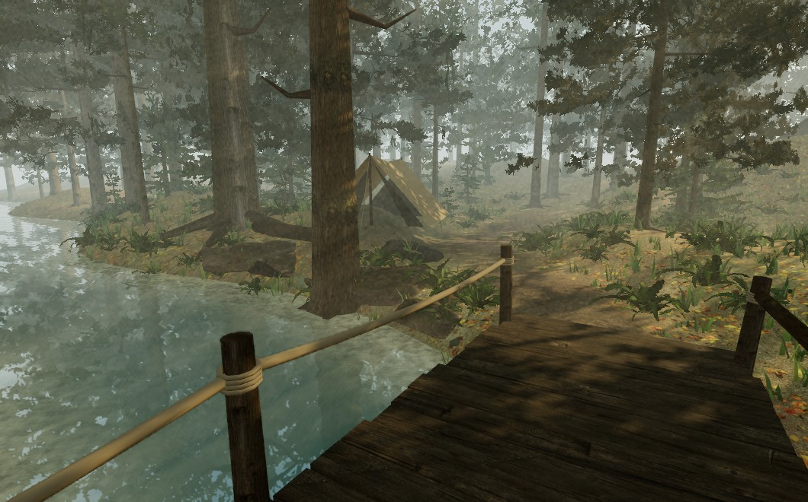

# 迷失林界

[在线进入森林](https://genshinau.github.io/mistwood-morning/) · [下载离线样片](https://raw.githubusercontent.com/genshinau/mistwood-morning/main/docs/index.html)



首段视觉样片以清晨林间小路和溪上木桥为中心，步行范围约 40 × 30 米。双击 `dist/迷失林界.html` 即可在支持 WebGL 2 的桌面浏览器离线体验。点击「进入森林」，用 WASD 移动、鼠标环顾，Esc 暂停。浏览器限制鼠标锁定时，可按住鼠标拖动环顾。

## 本地开发

使用 Node.js 22 或更高版本，在项目目录执行以下命令。

```sh
pnpm install
pnpm dev
```

执行 `pnpm build` 会检查 TypeScript 并生成 Vite 静态站点和内嵌全部材质的单文件版本。

GitHub Pages 使用 `main` 分支的 `docs/` 目录。更新样片后运行 `pnpm build` 并提交生成的 `docs/index.html` 即可更新在线版本。

## 素材

地面、步行小路、树皮与桥板使用 Poly Haven 的 [Forest Floor](https://polyhaven.com/a/forest_floor)、[Brown Mud](https://polyhaven.com/a/brown_mud)、[Bark Brown 02](https://polyhaven.com/a/bark_brown_02)、[Rough Wood](https://polyhaven.com/a/rough_wood)。

林冠来自 [Fir Tree 01](https://polyhaven.com/a/fir_tree_01)、[Pine Sapling Medium](https://polyhaven.com/a/pine_sapling_medium) 和 [Fir Sapling](https://polyhaven.com/a/fir_sapling)，已离线烘焙为分层图集。近景蕨类与苔石来自 [Fern 02](https://polyhaven.com/a/fern_02) 和 [Rock Moss Set 01](https://polyhaven.com/a/rock_moss_set_01)。上述美术素材使用 [CC0](https://polyhaven.com/license) 许可。Three.js 的许可随离线版嵌入。

